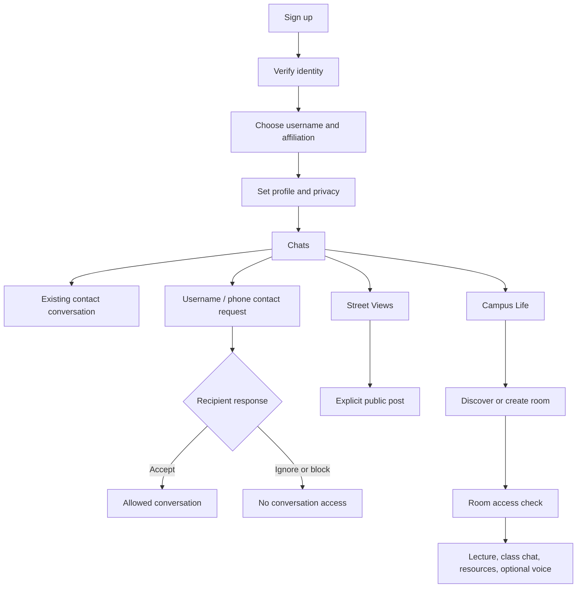

# User flows and permission boundaries

## Boundaries

- A public profile or username is not proof of an accepted private contact.
- A private phone number is never shown to profile viewers, followers, groups, or room participants.
- Public listing of a group or room never grants access to private content/materials.
- Room hosts/moderators can take only server-authorized actions.
- Reports of encrypted chat content require the reporting user to deliberately submit the relevant context.
- Current preview has no accounts or permission boundaries; it is not safe for private data.
